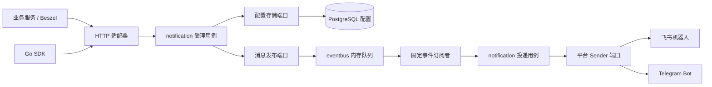

# Posthaste 系统设计

本文定义 Posthaste 首版实现的架构约束。工程规范见 [AGENTS.md](AGENTS.md)，HTTP 与 SDK 契约分别见 [API.md](docs/API.md) 和 [GO_SDK.md](docs/GO_SDK.md)。源码、构建及真实环境验收状态分别记录，不能由架构描述推定已部署。

## 1. 定位与边界

Posthaste 是内部自托管、单租户的消息／告警推送中心。多个业务系统提交统一消息，由服务端根据 caller 选择预配置目标组，再推送到一个或多个飞书机器人或 Telegram Bot 目标。

首阶段提供统一 HTTP API、Shoutrrr Generic Webhook 兼容、Go SDK，以及管理平台账号、群组出口和路由组的后台。数据库只保存配置，eventbus 负责进程内异步尽力投递；不建设消息历史、自动重试、幂等去重、持久化队列、重启恢复或最终回执查询。默认单实例，不设计多租户、后台用户账户体系、条件规则引擎、定时触发或高可用调度。平台机器人账号与后台管理员身份互相独立。

“支持扩展”指新增协议适配器或平台 Sender 可以接入既有用例，不表示首版预先实现所有插件、抽象或协议。

## 2. 技术基线与目录

| 组成 | 选择 | 职责 |
| --- | --- | --- |
| 服务端 | Go、allingo、fx | 进程、公共能力和模块化依赖注入 |
| HTTP | allingo 提供的 Gin | 协议、认证、API 和静态资源 |
| 业务组织 | DDD 分层单体 | 领域模型、应用编排、基础设施端口 |
| 内部异步 | `github.com/real-uangi/eventbus` | 单进程内存队列与固定订阅者 |
| 配置存储 | allingo DB、GORM、PostgreSQL | 账号、出口、路由组与关联 |
| 后台 | React、TypeScript、Vite、Tailwind CSS、pnpm | 单一同源 SPA，构建资源嵌入 Go |
| Go SDK | 同仓独立 Go module，仅标准库 | 公开 HTTP v1 消息客户端 |

架构参考 Icebreaker 的模块装配和分层规范，不复制其计费、用户、Edge、多站点、定时任务或视觉设计。根模块固定 allingo `v0.1.14`、fx `v1.24.0`；eventbus 固定具备 `Close(context.Context)` 的 `v0.0.0-20261111004406-7eee93697032`。不能照搬 Icebreaker 缺少 Close 的旧 eventbus 依赖。

源码目录如下：

```text
main.go / main_test.go                 # appOptions、fx.ValidateApp
adapter/
  http/                               # 路由、鉴权中间件、DTO、错误映射
  event/                              # 固定 eventbus 订阅与生命周期装配
internal/
  notification/
    domain/                           # 模型、存储和 Sender 端口
    application/                      # 配置、受理、投递、目标测试用例
    infra/                            # ORM、凭证加解密、Feishu/Telegram Sender
    fx.go
  auth/
    domain/                           # 管理员会话与认证端口
    application/                      # 登录、查询会话、退出
    infra/                            # 环境口令验证、内存会话实现
    fx.go
  shared/
    config/                           # 一次性解析环境配置
    events/                           # 最小进程内事件契约
    logfields/                        # 稳定日志字段
    fx.go                             # eventbus 等公共依赖
web/                                  # 唯一后台 SPA、静态资源嵌入入口
sdk/go/                               # 独立 go.mod；不依赖服务端
docs/                                 # HTTP 与 Go SDK 契约
```

不为当前两个业务域建立通用 repository、插件引擎或独立 routing/delivery 微服务。平台实现在 notification 的 infra 内，前端为实际平台提供对应配置表单，不使用动态 schema 表单框架。

## 3. 分层、端口与装配

| 层 | 负责 | 不能承担 |
| --- | --- | --- |
| HTTP / event adapter | 协议转换、外部边界校验、触发用例 | 组路由规则、数据库和平台 IO |
| application | 受理、组选择、目标展开、投递及配置用例编排 | SQL、GORM、HTTP client、存储算法 |
| domain | Message、Account、Target、TargetGroup、不变量及所需端口 | Gin、GORM、fx、平台 SDK |
| infra | 事务、ORM、加解密、平台 HTTP、内存会话 | 决定 caller 回退和跨域业务策略 |

notification 定义配置存储端口、消息发布端口和 `Sender` 端口。存储实现返回路由所需配置及完整目标快照；发布实现封装 eventbus；平台 Sender 负责平台配置校验、载荷编码和一次发送。应用层不直接依赖 eventbus 库类型或具体 Sender。

`Sender` 以平台类型提供 `ValidateAccount(credentials)`、`ValidateTarget(config)` 和 `Send(ctx, targetSnapshot, message) error`。通过 fx value group `notification_senders` 收集后，构造按平台类型查找的索引；不依赖 group 顺序，重复类型启动失败。账号写入校验新凭证，出口写入根据所选账号的平台校验群组配置；发送时仅解码可信快照和处理外部平台响应，不逐层重复校验。

auth 通过口令验证与会话存储端口实现登录等用例。notification 与 auth 之间没有业务调用；HTTP 适配器先完成管理员会话认证，再调用配置用例。

根入口使用 `app.Current().Option(...).Run()`，装配 `common.Module`、`db.Module`、shared、两个业务域、事件适配器、HTTP 适配器和 web。新增模块必须检查构造依赖与注册是否完整，不能仅依靠模块的书写顺序假设启动/停止顺序。

## 4. 配置数据与一致性

### 4.1 模型

所有实体 ID 使用 UUID 字符串，时间使用 UTC 保存、RFC3339 表达。ORM 模型属于 infra，不对外直接返回。

| 模型 | 必要字段 | 约束 |
| --- | --- | --- |
| Account | id、name、platform、enabled、credentialsCiphertext、创建/更新时间 | platform 为 feishu/telegram，创建后不修改 |
| Target | id、name、accountId、enabled、config、创建/更新时间 | 一个出口属于一个账号，不再持有平台或凭证 |
| TargetGroup | id、name、caller、创建/更新时间 | UI 称“路由组”；caller 唯一，保留 default |
| GroupTarget | groupId、targetId | 组合唯一，引用真实组和目标 |

账号与出口是一对多关系，路由组与出口是多对多关系：`Account → Target ← GroupTarget → TargetGroup`。不额外建立平台 Chat 表；同一个实际群由不同账号发送时，是各自账号下的不同出口。

首版采用配置实体的硬删除。删除路由组时在同一事务清除其成员；被路由组引用的出口禁止删除，被任何出口引用的账号也禁止删除（含已禁用出口）。Account→Target 和路由组成员均声明 FK RESTRICT。存储实现以引用约束及事务维护关系，删除与绑定并发也不能产生悬空关联。不增加软删除历史、版本快照表或配置缓存。

平台凭证属于账号，公开目的地 config 属于出口：

| 账号平台 | 出口公开 config | 账号仅写 credentials |
| --- | --- | --- |
| feishu（群 Webhook） | `{}`，每个账号只能一个固定群出口 | webhookUrl、可选 signingSecret |
| telegram | chatId（string）、可选 messageThreadId（正整数） | botToken |

账号读取只返回 `credentialsConfigured`，不返回密文、明文或凭证掩码。创建账号时凭证必需；更新账号省略整个 credentials 时保留原值，提供时整体替换，不作字段合并。同一账号多个出口共用一份凭证，更新账号即可影响它们的后续受理。出口接口只保存 accountId 和 config，不再接受平台或凭证。

账号平台创建后不可修改；出口可以更换 accountId，并按新账号平台提交完整 config。为确保 Webhook 单出口约束，存储写出口时锁定所选账号，再排除当前出口计数；禁用出口也占名额，第二个返回 409。TG 不设置单出口限制。false、空列表和凭证省略都必须显式处理，不能由 ORM 零值更新规则忽略。

账号停用只影响后续受理，不改写子出口的 enabled。有效出口需同时满足账号和出口启用；恢复账号后，原本启用的出口重新可用。入队快照包含账号 ID、平台、凭证和目的地配置，账号凭证或启停变化不会追溯修改既有快照。

本次是未发布首版的配置 schema 调整，不提供旧目标凭证的自动回填或双写。若已使用旧 schema，需显式迁移配置，并将旧密文解密后以账号 ID 重新加密；AutoMigrate 不能代替数据迁移，也不能直接搬用旧密文。

### 4.2 默认组和路由

模型迁移后，由配置初始化用例幂等创建 `caller=default` 的空组；其名称可以修改，caller 不可修改，组不可删除。首次部署管理员需自行添加目标并绑定成员；空默认组不会触发自动补齐或发送。

caller 是区分大小写的配置键，按 query 解码后的字符串精确匹配；缺省或空字符串使用默认组，非空但不存在也使用默认组。不将其转换为用户名，不推导第三方协议，不自动创建组。

命中已存在组时，只选择该组中“账号和出口都启用”的目标；即使一个目标也没有，也不能再转投默认组。默认组本身没有可用目标同样返回 503。组成员去重，数组顺序不定义投递优先级；快照按目标 ID 稳定展开，平台调用顺序不构成对外顺序保证。

每次受理通过单次关联查询读取路由组、成员、出口和账号的同一一致视图，避免配置并发更新时拼接半新半旧的凭证与目的地。配置提交后对后续受理生效，不维护需要失效同步的内存缓存。

## 5. 消息链路与可靠性



### 5.1 受理

1. HTTP 适配器验证入口 Bearer、媒体类型及 64 KiB body 上限，解析 JSON，校验正文非空与 format。
2. 接收用例解析 caller 对应组和启用目标；没有可用目标或配置库不可用返回安全错误。
3. 生成 messageId，复制消息及目标 config/credentials 为不可变 `DispatchEnvelope`。快照包含请求 caller、实际组、是否回退和受理时间，用于安全日志关联。
4. 发布端口仅调用一次 `Publish("notification.dispatch.requested.v1", envelope)`，成功后返回真实 HTTP 202 和 messageId。

事件发布后，所有 slice、map、字节缓冲及凭证引用不得复用为可变对象。HTTP 请求结束不取消已受理的投递；handler 为平台请求建立独立且有超时的 context，不能继续持有 Gin Context 或已取消的请求 context。

目标测试用例先校验管理员指定出口存在且账号和出口都启用，再复用上述快照与发布步骤，仅包含该出口。它不经过 caller 路由，也不绕过父子开关，不另建同步发送通道。

### 5.2 执行

只注册一个固定业务订阅者。订阅者调用投递用例，顺序遍历本消息快照，每个目标调用其平台 Sender 一次；错误记录后继续下一个。不同消息由 eventbus executors 并发执行，不额外启动发送 goroutine 或线程池。

每次目标请求独立受 `POSTHASTE_SEND_TIMEOUT` 限制，默认 5 秒。超时、限流和平台业务失败均结束本次尝试；不等待 retry-after、不重新入队、不分片、不截断、不自动降级重发。正常错误不得误报成功；处理器完成只表示本轮遍历结束，日志分别记录目标结果。

### 5.3 明确不提供的保证

- Publish 成功只表示进入内存 dispatcher 队列，不等待订阅者或平台响应。
- 队列和消息均不持久化。重启、进程异常、handler panic 或停机预算耗尽可能丢失全部或部分未处理目标。
- 无幂等键和去重。相同请求、客户端重试及平台已收到但响应丢失时，都可能重复推送。
- 无消息历史、回执接口、恢复扫描、outbox 或消息状态表。messageId 只用于日志关联。
- 不保证消息完成顺序，不承诺同一消息各目标同时收到，也不承诺最终送达。

eventbus 按运行时函数名识别订阅者，同 topic 的同源闭包/同名方法可能互相覆盖，因此不能按配置目标动态 Subscribe。handler 返回错误只会被总线记录，不触发重试；不可用 `MustPublish` 掩盖回压或在 handler 内递归发布投递工作。

## 6. 平台映射与扩展

统一 Message 包含可选 title、必需 message 和 `text` / `markdown` format。title 始终为普通文字；format 省略时为 text。扩展消息模型不能把某个平台的原生 JSON、token、卡片或 HTTP Context 塞入公共消息。

| 平台 | text | markdown |
| --- | --- | --- |
| 飞书自定义机器人 | text 消息，标题与正文以空行连接 | interactive 卡片 schema 2.0，纯文本标题与 Markdown 正文组件 |
| Telegram 官方 Bot API | sendMessage，不设置 parse_mode，标题与正文以空行连接 | sendRichMessage，rich_message.markdown；拼接标题时转义其 Markdown 元字符 |

共同基础语法为 `**粗体**`、`*斜体*`、HTTP(S) 链接、行内/围栏代码、列表和引用。正文由对应平台原生解析，不承诺平台扩展语法或复杂嵌套完全一致；首版不提供原生卡片、附件和按钮载荷接口，也不引入 Markdown 转换依赖。

Sender 使用明确超时的 HTTP client，检查 HTTP 状态和平台业务结果：飞书检查业务 code，Telegram 检查 ok；HTTP 200 但业务失败仍是失败。超出平台限制时仅该目标失败，不截断或拆分以制造部分成功。

飞书凭证在写入时校验官方 HTTPS webhook 地址与路径；设置 signingSecret 时按官方签名规则发送。Telegram 使用固定官方 API 地址，不接受由消息指定的 API Host。平台 raw error、含 token 的 URL 及上游响应正文不能进入日志或返回到 eventbus。

当前飞书类型是固定群 Webhook，不能通过新增 chatId 跨群。后续飞书应用机器人将作为独立平台 Sender 接入：账号保存应用身份和凭证，出口保存 chatId；本次不实现应用 API、访问令牌管理或群自动发现。

新增平台只增加对应 infra Sender、fx 注册、账号/出口校验与后台表单，并补充契约和测试；不修改 caller 路由和通用投递循环。新增原生告警入口时，在 adapter 中转换为同一接收命令；没有第二种协议需求前，不增加通用解析器注册框架。

## 7. 后台、认证与凭证

后台提供登录、账号列表/编辑、账号下的群组出口、路由组、默认路由组配置及出口测试。只有管理员一种身份，无用户表、角色权限、注册、配额或计费。出口编辑选择账号，只填写目的地；凭证统一在账号中维护。测试操作显示“已入队，请在目标平台确认”，不展示虚构投递记录。管理接口和安全错误状态以 API 文档为准。

后台使用环境口令；验证实现避免将原始口令写入持久化、日志或错误，比较使用固定长度摘要的常量时间比较。登录生成高熵随机 opaque session ID，服务端仅在内存中保存其摘要和到期时间；固定 12 小时到期，不滑动续期。过期会话在访问或登录清理时移除，不创建常驻清理任务。退出撤销会话，重启清空会话。

Cookie 名为 `posthaste_session`，HttpOnly、SameSite=Lax、Path=/api/v1/admin，不设置跨域 Domain；生产 HTTPS 使用 Secure。所有管理 POST，包括登录和退出，要求 Origin 存在且与 `POSTHASTE_PUBLIC_URL` 的 origin 相同；不信任请求传入的 Host 作为期望 origin。单一同源后台不额外建立跨域 CORS 或前端可读的管理 Token。

入口仅接受 `POSTHASTE_INGRESS_TOKEN` 的 Bearer，不接受管理 Cookie、后台口令或 query Token。持有入口 Token 的内部服务可以选择任意 caller，caller 不构成权限隔离。

账号 credentials 在 infra 通过 AES-GCM 加密，使用随机 nonce，密文携带解密所需 nonce，账号 ID 作为附加认证数据。主密钥由环境提供，不入库。修改主密钥不能直接解密已有凭证，需显式运维重加密或重新配置，不尝试旧密钥/空密钥兜底。明文只存在于校验、加密及投递所需内存中；整个加解密算法不进入应用层。

allingo 默认数据库日志可能展开 SQL，故 credentials 在进入 ORM 前已为密文；禁止把明文写入临时列、SQL 条件或 ORM 调试日志。平台网络错误必须先映射为安全 reason，再交给业务或 eventbus 日志。

## 8. 生命周期与运行配置

### 8.1 生命周期

启动解析配置并校验必要项，建立存储，完成模型迁移及默认组初始化，注册 Sender 和固定订阅者后才对外接收消息。路由/静态资源注册在 HTTP OnStart 之前完成；数据库不可用或配置非法时启动失败，不以空配置接受请求。

eventbus 构造函数注册 `Close(ctx)` 的 Fx OnStop。HTTP/Gin 的装配需显式依赖已注册关闭 hook 的 bus，以及注册迁移/默认组初始化 hook 的配置启动组件；例如在共同父 scope 对 Gin 使用声明这些依赖的 `fx.Decorate`。这些组件先注册 hook，HTTP 后注册 hook，才能保证正序启动时先初始化配置再监听、逆序停止时先 HTTP Shutdown 再 bus.Close，不能只排列 Module 达到此目的。bus 构造不反向依赖 Gin，配置启动组件的构造只注册生命周期、在 OnStart 执行初始化 IO。数据库连接的释放通过生命周期管理，必须晚于依赖它的在途 HTTP 请求。

allingo `app.Run()` 为所有 Fx Stop 共用 15 秒，HTTP Shutdown 也使用同一 context。bus.Close 继承剩余预算，不另起无限 background context；如果 HTTP 耗尽预算，后续 bus hook 也可能无法执行。Close 超时不会强制终止运行中的 handler，因此不能承诺完全排空或固定“HTTP 5 秒 + bus 10 秒”。该限制符合首阶段尽力投递语义。

### 8.2 配置表

| 环境变量 | 要求/默认 | 用途 |
| --- | --- | --- |
| `DB_DSN` | 必填，无默认 | allingo PostgreSQL 连接串 |
| `POSTHASTE_PUBLIC_URL` | 必填，生产 HTTPS origin，无 userinfo/query/fragment | 后台预期来源；首版 SPA 以根路径部署 |
| `POSTHASTE_ADMIN_PASSWORD` | 必填，无默认 | 单管理员口令，不是入口 Token |
| `POSTHASTE_INGRESS_TOKEN` | 必填，无默认，与后台口令不同 | 消息入口高熵 Bearer Token |
| `POSTHASTE_ENCRYPTION_KEY` | 必填，标准 Base64 编码的 32 字节密钥 | 平台凭证 AES-GCM |
| `POSTHASTE_EVENTBUS_EXECUTORS` | 默认 `4`，必须为正整数 | 并行处理消息数量 |
| `POSTHASTE_EVENTBUS_DISPATCHER_QUEUE_SIZE` | 默认 `64`，必须为正整数 | dispatcher 有界队列 |
| `POSTHASTE_EVENTBUS_EXECUTOR_QUEUE_SIZE` | 默认 `64`，必须为正整数 | executor 有界队列 |
| `POSTHASTE_SEND_TIMEOUT` | 默认 `5s`，必须为正 Go duration | 每个目标请求时间限制 |
| `HTTP_PORT` | allingo 默认 `8080` | HTTP 监听端口 |
| `RUN_MODE` | 部署显式设置 `release` | allingo 运行模式，避免生产启动调试 pprof |

dispatcher 数量固定为 1；executor 允许并发，因此仍无完成顺序保证。eventbus Publish 本身最多等待 5 秒；接入代理应允许覆盖这个等待时间。只在未提供可选配置时应用默认，显式非法值必须报错，不能被通用读取 helper 静默改为默认。

SDK 的路径前缀支持只表示其能调用网关转发的带前缀地址，不承诺后台 SPA 支持任意部署 base path。首版提供一个同源 HTTPS 入口，由外部反向代理终止 TLS；不自建证书管理和多站点路由。

### 8.3 可观测性

受理和逐目标日志使用稳定字段：messageId、callerRequested、callerResolved、fallback、accountId、targetId、platform、outcome、reason、elapsedMs。记录未知 caller 进入默认组的事实，不能将其记成正常命中；不输出正文、平台凭证、Cookie、Authorization 或完整 webhook URL。

区分请求受理/拒绝与平台成功/失败；可通过计数和耗时指标观察，指标标签仅采用平台、结果等有限值，不把 messageId 或任意 caller 作为标签。eventbus 不直接提供的持久状态或队列观测不能虚构成已实现监控能力。

## 9. SDK、开发顺序与验收

Go SDK 为 `sdk/go` 独立模块，仅标准库，使用公开 HTTP 协议，不导入服务端代码；具体 Config、SendRequest、Acceptance、APIError 和错误链以 SDK 文档为准。默认 10 秒 HTTP 超时，无自动重试，仅合法 202 返回受理结果；客户端取消或超时不能推断服务端未受理。

首版实现按以下顺序组织：

1. 根模块及 fx 装配、配置解析、纯装配检查；接入 allingo 和支持 Close 的 eventbus。
2. 配置模型/事务/凭证存储、默认组初始化、管理员会话和管理 API。
3. 接收与投递用例、固定订阅者、飞书与 Telegram Sender、纯单元测试。
4. HTTP v1 协议、Generic 示例和 Go SDK 同步实现，锁定共同的请求/响应契约。
5. 后台表单与静态资源嵌入、构建检查；真实 PostgreSQL、浏览器和平台联调另行授权。

默认验证使用内存 fake、模拟 RoundTripper、HTTP recorder 和 `fx.ValidateApp`。重点覆盖 caller 各分支、目标去重与空组、凭证省略更新、并发配置一致性、快照隔离、逐目标失败继续、平台业务失败、队列关闭、会话和脱敏。SDK 必须在自己的模块中独立测试；嵌套模块不会被根 `go test ./...` 覆盖。

所有消息入口变更同步检查 API、SDK、示例和测试；目标平台扩展同步检查 Sender、fx 注册、后台配置表单及平台文档。纯单元测试与编译不替代 PostgreSQL、浏览器和真实平台验收；具体执行状态见 README 及交付记录。

## 10. 发布与容器架构

`release.yml` 只监听 `push` 的 `v*` 标签，在 gate 中严格接受 `^v(0|[1-9][0-9]*)\.(0|[1-9][0-9]*)\.(0|[1-9][0-9]*)$`，并验证 `tag^{commit}` 是 `origin/main` 的祖先。验证历史归属而非仅比较 main 顶端 SHA；被打标签的提交本身必须包含发布工作流、GoReleaser 配置、Dockerfile 和待发布代码。

流水线顺序为 gate → 可复用 Checks → publish。Checks 保留现有 main/PR 触发，同时提供 `workflow_call`，以只读权限执行前端、服务端、独立 SDK 和 GoReleaser 配置检查；仅 publish 使用 `contents: write`、`packages: write` 和 `GITHUB_TOKEN` 创建 GitHub Release 并推送 GHCR，不提供运行时数据库或平台密钥。

根 [.goreleaser.yaml](.goreleaser.yaml) 固定使用 GoReleaser OSS `v2.15.2`：CI 按 frozen lockfile 安装前端依赖，GoReleaser 的 before 只执行 `pnpm --dir web build`，再以 `CGO_ENABLED=0` 交叉编译 `linux/amd64` 和 `linux/arm64`。按完整标签（含 `v`）命名两份 `posthaste_<tag>_linux_<arch>.tar.gz` 归档，仅包含程序和公开占位配置 `.env.example`，生成 SHA256 `checksums.txt` 后上传至同标签 GitHub Release。

镜像通过 `dockers_v2` 和 Buildx 组装，不使用 QEMU。根 [Dockerfile](Dockerfile) 基于包含 CA 证书的 `gcr.io/distroless/static-debian13:nonroot`，只 COPY `TARGETPLATFORM` 对应静态产物，没有 RUN 指令，不执行目标程序、添加 `--version` 探测、构建前端或包含 `.env`/密钥/数据库；默认 release 模式和 8080 端口。版本标签与 `latest` 指向 `ghcr.io/real-uangi/posthaste` 的多架构镜像；`latest` 表示最近一次成功镜像发布，不表达 main 或最高版本。

SDK 标签不触发此工作流。为防 GoReleaser 从 `sdk/go/*` 误选 prior tag，仅在临时 publisher checkout 删除本地 SDK 标签，并通过 `GORELEASER_CURRENT_TAG` 显式指定服务端标签；不删除远端标签或修改 SDK 发布机制。GHCR 初次发布后由组织管理员手动公开 package 并验证匿名拉取，仓库可见性不替代 package 可见性。容器使用方法见 README；本地配置验证不等于正式发布或部署验收。

## 11. 依据与参考

- 本机 Icebreaker 的 `AGENTS.md`、`main.go`、各域 `fx.go` 和事件装配：参考其工程边界，避免复制与现行规范不一致的历史 IO 写法。
- [allingo](https://github.com/real-uangi/allingo)：公共模块、数据库、HTTP、结果信封与进程生命周期；生命周期细节同时核对本机 v0.1.14 源码。
- [eventbus 契约](https://github.com/real-uangi/eventbus/blob/7eee93697032364d93e50e57bc6b16890c8b1e39/README.md)：内存、并发、发布、订阅身份和 Close 边界。
- [Beszel Generic](https://beszel.dev/guide/notifications/generic)：JSON title/message、自定义请求头与 query 转发。
- [飞书卡片与自定义机器人](https://open.feishu.cn/document/feishu-cards/quick-start/send-message-cards-with-custom-bot)、[Telegram Rich Message](https://core.telegram.org/bots/api#rich-message-formatting-options)：平台 Markdown 映射，核对日期 2026-11-15。
- [Go Modules 版本规则](https://go.dev/ref/mod#vcs-version)：独立子模块的模块路径和标签前缀。
